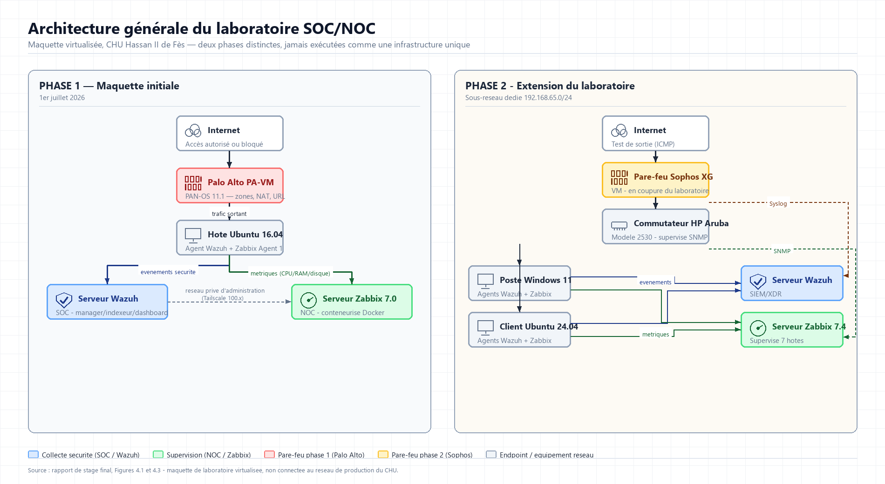
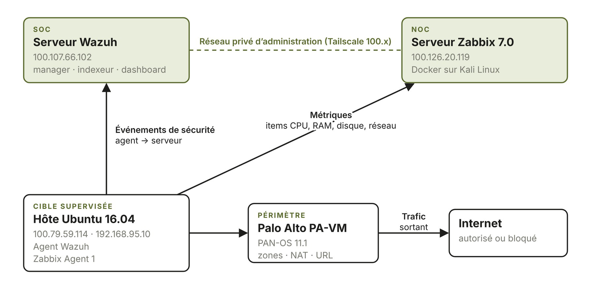
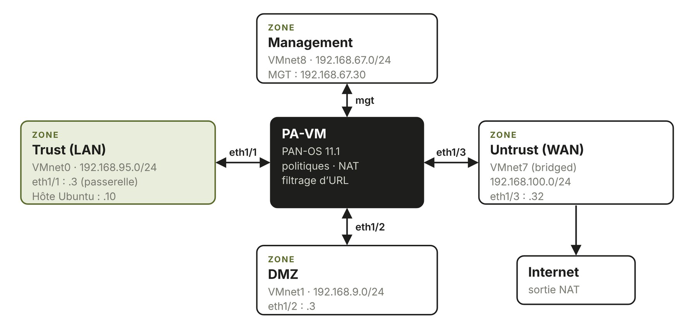
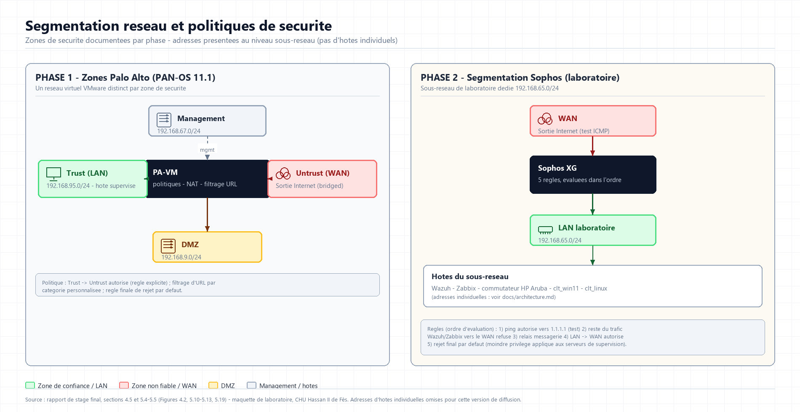
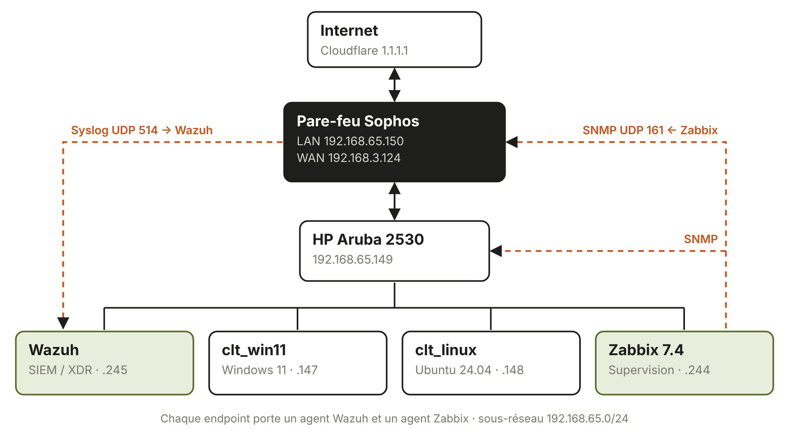
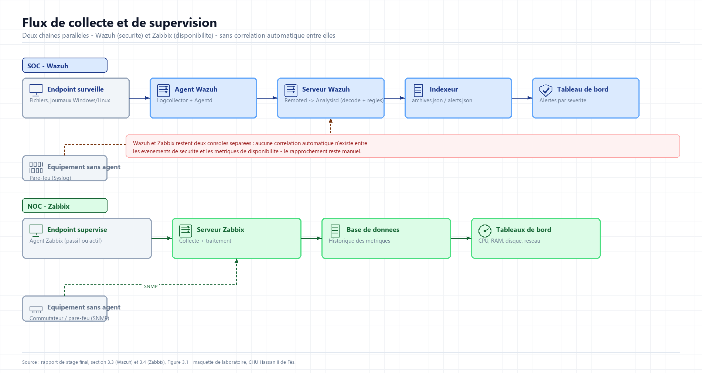
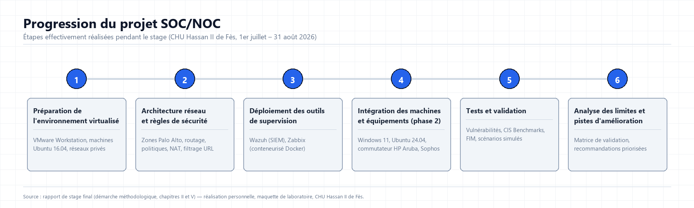
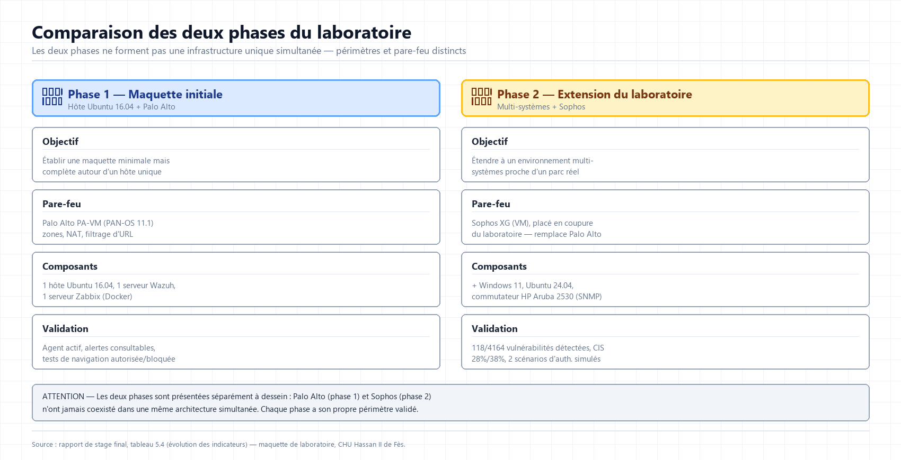

# Architecture

## Vue d'ensemble

Les deux phases sont présentées **côte à côte, jamais fusionnées** : le pare-feu Palo Alto (phase 1) et le pare-feu Sophos (phase 2) n'ont jamais coexisté dans une même exécution de la maquette. Schéma original — sources et méthode dans `../assets/diagrams/SOURCES.md`.

## Phase 1 — maquette initiale

La plateforme de la phase 1 est composée de quatre éléments : l'hôte Ubuntu 16.04 LTS (cible supervisée), le serveur Wazuh (volet SOC), le serveur Zabbix (volet NOC) et le pare-feu Palo Alto (placé sur le chemin du trafic entre l'hôte Ubuntu et Internet).

Répartition physique : trois machines virtuelles distinctes (séparation des rôles — l'indisponibilité d'un serveur de supervision n'affecte pas directement l'hôte supervisé).

Un réseau privé d'administration (plage Tailscale 100.x, non exposée sur Internet public) relie les composants de supervision entre eux, distinct du trafic de navigation qui traverse le pare-feu.

### Flux principaux

| Flux | Source | Destination | Finalité |
|---|---|---|---|
| Événements SOC | Agent Wazuh sur Ubuntu | Serveur Wazuh | Collecte et analyse des événements de sécurité |
| Métriques NOC | Zabbix Agent 1 sur Ubuntu | Serveur Zabbix | Mesure de l'état et des performances de l'hôte |
| Navigation sortante | Hôte Ubuntu | Internet via Palo Alto | Accès contrôlé aux ressources Internet |
| Administration privée | Composants de la maquette | Réseau privé 100.x | Accès aux composants sans exposition directe sur Internet |

### Contrôle périmétrique (Palo Alto)

Chaque interface du pare-feu est associée à une zone de sécurité (Management, Trust/LAN, DMZ, Untrust/WAN) et à un réseau virtuel VMware distinct, reproduisant à petite échelle la séparation entre réseau d'administration, réseau interne, DMZ et accès Internet. Les politiques de sécurité et les règles NAT s'appliquent entre ces zones.

### Segmentation réseau et politiques (vue combinée des deux phases)

Schéma original résumant les zones Palo Alto (phase 1) et la segmentation Sophos (phase 2). Les adresses individuelles des hôtes ne sont pas reprises dans ce schéma (seules les plages de sous-réseau apparaissent) — voir le tableau d'adressage complet en annexe du rapport (non publié) pour le détail hôte par hôte.

## Phase 2 — extension du laboratoire multi-systèmes

Pour se rapprocher d'un parc plus réaliste, la plateforme a été étendue à un laboratoire dédié (sous-réseau de laboratoire isolé), avec quatre objectifs : couvrir des systèmes hétérogènes (Windows 11 et Ubuntu 24.04), exploiter les modules avancés de Wazuh, intégrer un pare-feu Sophos placé en coupure du laboratoire, et superviser un commutateur HP Aruba par SNMP.

- Le pare-feu **Sophos** assure la sortie Internet du laboratoire et transmet ses journaux à Wazuh via Syslog (UDP 514).
- Le commutateur **HP Aruba 2530** relie les serveurs et les postes ; il est supervisé par Zabbix via SNMP, tout comme le Sophos.
- Le serveur **Wazuh** reçoit les événements des agents des deux postes (Windows 11, Ubuntu 24.04) ainsi que les journaux Syslog du Sophos.
- Le serveur **Zabbix** collecte les métriques des postes et des serveurs par agent, et celles du Sophos/commutateur par SNMP.

## Complémentarité des composantes

| Composant | Question à laquelle il répond | Type de données |
|---|---|---|
| Wazuh | Quels événements de sécurité sont remontés par l'hôte ? | Journaux, alertes, informations d'agent |
| Zabbix | Quel est l'état de disponibilité et de performance ? | Métriques système, stockage et réseau |
| Pare-feu (Palo Alto / Sophos) | Quels flux sont autorisés, traduits, bloqués ou journalisés ? | Zones, règles, sessions, trafic et filtrage Web |

**Point important :** les trois briques fournissent des points de vue complémentaires sur la même infrastructure, mais **ne constituent pas, à elles seules, une corrélation automatique** entre événements de sécurité et indicateurs de disponibilité — ce rapprochement reste manuel dans cette maquette (voir `security-and-limitations.md`).

## Flux de collecte (Wazuh) et de supervision (Zabbix)

Les deux chaînes sont représentées séparément à dessein : Wazuh (collecte et analyse des événements de sécurité, via agent ou Syslog) et Zabbix (supervision des ressources, via agent ou SNMP) restent deux consoles indépendantes dans cette maquette — aucune corrélation automatique entre elles n'a été implémentée.

## Progression du projet et comparaison des phases

