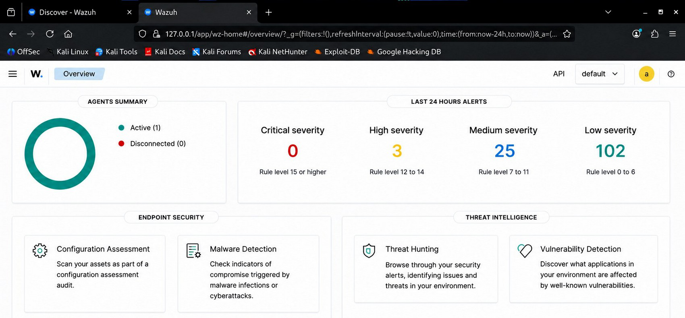
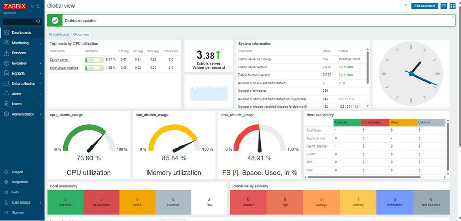

# Scénarios de validation et résultats observés

> Les résultats ci-dessous décrivent l'état de la **maquette de laboratoire** à la date des relevés. Ils ne constituent ni un audit de sécurité du CHU, ni une garantie de disponibilité permanente — ce sont des preuves ponctuelles (captures d'écran datées), pas une surveillance continue.

## Tableau de bord Wazuh (vue d'ensemble)

La console confirme qu'un agent est actif et que les alertes sont classées par sévérité. **Ces chiffres concernent exclusivement la machine de test du laboratoire** sur une fenêtre de 24 heures — ils ne reflètent ni une attaque réelle, ni l'état du réseau de production du CHU.

## Vue globale Zabbix

Confirme la disponibilité des hôtes supervisés et les indicateurs système (CPU, mémoire, stockage) de la maquette.

## Matrice de validation (synthèse)

| Domaine | Vérification | Statut |
|---|---|---|
| Wazuh | Gestionnaire, indexeur et console accessibles | ✅ Validé |
| Wazuh | Endpoint Ubuntu actif, alertes consultables | ✅ Validé |
| Zabbix | Déploiement Docker, hôte et métriques visibles | ✅ Validé |
| Palo Alto | Interfaces, zones, routage, politiques, NAT, filtrage URL | ✅ Validé |
| Wazuh (phase 2) | Déploiement multi-OS, vulnérabilités, CIS, FIM | ✅ Validé |
| Wazuh (phase 2) | Scénarios d'authentification simulés détectés et rattachés à MITRE ATT&CK (T1110) | ✅ Validé |
| Sophos | Politique réseau et intégration SNMP/Syslog | ✅ Validé |
| Zabbix (phase 2) | Sept hôtes supervisés (agents + SNMP + ICMP) | ✅ Validé |
| Wazuh | Lisibilité des alertes (volume important issu des journaux du pare-feu) | ⚠️ À améliorer (filtrage/agrégation recommandés) |
| Zabbix | Vérifications actives de l'agent Windows | ⚠️ À vérifier (configuration non visible intégralement) |
| Zabbix / Wazuh | Chiffrement des échanges agent-serveur | ❌ Non activé dans la maquette — amélioration recommandée |

## Scénarios de test volontaires (pas des incidents réels)

- **Échecs d'authentification Windows** : scénario de connexions avec identifiants erronés, conduit volontairement sur le poste de test. Détecté par la règle de corrélation Wazuh (niveau 10, technique MITRE ATT&CK T1110 — Brute Force).
- **Échecs d'authentification SSH (Linux)** : tentatives de connexion avec mot de passe erroné, émises volontairement depuis une machine du laboratoire vers un compte local du poste de test. Détectées par les règles Wazuh correspondantes (techniques T1110.001, T1021.004).

Ces deux scénarios sont des **tests volontaires destinés à valider la chaîne de détection**, pas des incidents de sécurité réels.

## Limites de la validation

- L'échelle du laboratoire (quelques hôtes, un commutateur, un pare-feu par phase) ne permet pas d'évaluer le comportement de la plateforme avec des centaines d'agents ou de flux simultanés.
- Les observations sont ponctuelles (captures à un instant donné), pas une disponibilité continue mesurée dans la durée.
- Aucune corrélation automatique n'a été mise en œuvre entre les événements Wazuh et les métriques Zabbix — le rapprochement reste manuel.

Détail complet des limites et recommandations : voir `security-and-limitations.md`.
